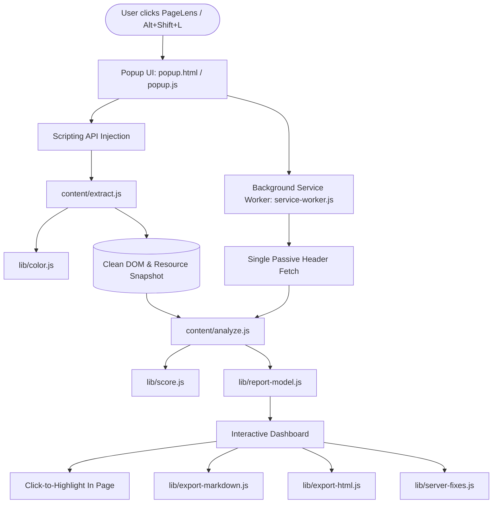

# PageLens 🔍

> **Plain-English audits and reports on any website, repository, or package: accessibility, speed, design, privacy, and security.**  
> *Free, 100% private, client-side, zero AI, and no API keys required.*

[](LICENSE)
[](manifest.json)
[](manifest.json)
[](#privacy--security-guarantees)
[](#overview)

---

## Table of Contents

- [Overview](#overview)
- [Why PageLens?](#why-pagelens)
- [Core Features & Modes](#core-features--modes)
  - [1. Website Mode](#1-website-mode)
  - [2. Repository Mode (GitHub & Forges)](#2-repository-mode-github--forges)
  - [3. Package Mode (npm & PyPI)](#3-package-mode-npm--pypi)
- [Role-Based Perspectives](#role-based-perspectives)
- [Architecture & Tech Stack](#architecture--tech-stack)
- [Installation Guide](#installation-guide)
  - [Loading Unpacked into Chrome / Chromium Browsers](#loading-unpacked-into-chrome--chromium-browsers)
- [Usage & Keyboard Shortcuts](#usage--keyboard-shortcuts)
- [Privacy & Security Guarantees](#privacy--security-guarantees)
- [Project Structure](#project-structure)
- [Contributing](#contributing)
- [License](#license)

---

## Overview

**PageLens** is an open-source browser extension (Manifest V3) that inspects websites, open-source repositories, and software packages to deliver clear, actionable reports. Instead of overwhelming you with cryptic warnings or generic AI output, PageLens uses a deterministic, rule-based engine that executes directly in your browser.

- **No AI Hallucinations**: Every finding is computed using transparent, standards-based rules (WCAG 2.1, W3C standards, RFC security guidelines, Core Web Vitals).
- **100% Private & Passive**: No tracking, no analytics, no external servers. It never reads form inputs, passwords, or cookie values.
- **Role-Tailored Views**: Switch instantly between **Everyday User**, **Designer**, **Developer**, and **Security Analyst** modes to view findings ranked by what matters to you.
- **Instant Remediation**: Click any issue to outline the problem element directly in the page, generate ready-to-paste server configurations, or export full reports to Markdown, HTML, or PDF.

---

## Why PageLens?

Most web auditing tools fall into two extremes: complex developer-only panels with thousands of raw logs, or superficial cloud services requiring accounts, monthly subscriptions, and invasive tracking.

PageLens rethinks auditing from the ground up:
1. **Lightweight & Fast**: Built with pure vanilla JavaScript with zero third-party framework overhead.
2. **Context-Aware**: Audits not just rendered websites, but also GitHub repositories and package registries.
3. **Actionable Fixes**: Provides concrete code snippets and platform-specific configs (Nginx, Apache, Caddy, Vercel, Netlify, Next.js, Express, IIS) to fix identified issues immediately.

---

## Core Features & Modes

PageLens provides three specialized inspection modes accessible directly from the top navigation bar:

```
+-------------------------------------------------------------+
|   [ Website Mode ]   |   [ Repo Mode ]   |   [ Package Mode ]|
+-------------------------------------------------------------+
```

### 1. Website Mode

When viewing any webpage, PageLens runs a passive scan measuring six essential pillars:

#### ♿ Accessibility (a11y)
- **WCAG 2.1 AA & AAA Contrast**: Calculates color contrast ratios between text and background using APCA/W3C luminance algorithms.
- **Touch & Click Targets**: Identifies interactive elements smaller than 48×48px (or 24×24px compact thresholds) with insufficient spacing.
- **Images & Media**: Flags missing, empty, or redundant `alt` attributes, SVG accessibility tags, and unlabeled icon buttons.
- **Form Controls**: Verifies explicit `<label for="...">` associations, `aria-label`, `aria-labelledby`, and placeholder misuse.
- **Document Structure**: Detects skipped heading levels (e.g. `<h1>` followed directly by `<h3>`), duplicate element IDs, and missing ARIA landmarks.

#### ⚡ Speed & Performance
- **Transfer Weight & Composition**: Measures payload sizes across scripts, stylesheets, images, fonts, and media.
- **DOM Depth & Complexity**: Flags excessive DOM node counts (>1,500 elements) or deep nesting trees (>32 levels) causing reflow lag.
- **Resource Bottlenecks**: Identifies uncompressed images, missing `loading="lazy"` attributes, and render-blocking external scripts.
- **Web Vitals Readiness**: Detects viewport configuration issues, font swapping strategies (`font-display: swap`), and layout shifts.

#### 🎨 Design & UI/UX
- **Design Token Extraction**: Automatically reverse-engineers the page's color palette (dominant, background, text, borders, accents) and typography scales.
- **Typography Scale**: Analyzes font families, base font sizing, line lengths (optimal 45–75 character reading bounds), and type hierarchy.
- **Responsive Geometry**: Verifies mobile viewport meta tags, zoom locks (`user-scalable=no`), and horizontal overflow.
- **Copy Design Tokens**: One-click export of CSS Custom Properties (`--color-bg-1`, `--font-heading`, `--text-base`).

#### 🔒 Security & Server Headers
- **Passive Header Audit**: Re-fetches headers using a single passive request (`credentials: 'omit'`) to evaluate:
  - `Content-Security-Policy` (CSP)
  - `Strict-Transport-Security` (HSTS)
  - `X-Content-Type-Options` (nosniff)
  - `X-Frame-Options` (clickjacking defense)
  - `Referrer-Policy`
  - `Permissions-Policy` (camera, microphone, geolocation restrictions)
- **Automated CSP Builder**: Generates production-ready Content-Security-Policy policies (Strict Nonce-based or Origin Allowlist) tailored to the resources actually loaded by the page.
- **Server Remediation Recipes**: Instantly outputs ready-to-paste configurations for **Nginx**, **Apache**, **Caddy**, **Cloudflare Pages / Netlify**, **Vercel**, **Next.js**, **Express**, and **IIS**.
- **`security.txt` Check**: Automatically verifies the presence of `/.well-known/security.txt` (RFC 9116).

#### 🛡️ Privacy & Trackers
- **Tracker Detection**: Categorizes third-party scripts and beacons by provider (Google, Meta, TikTok/ByteDance, Amazon, Microsoft, Criteo, Hotjar, and more).
- **Cookie Security Audit**: Inspects cookie attributes (`Secure`, `HttpOnly`, `SameSite`) without ever reading or storing actual cookie values.
- **Storage Inspection**: Audits `localStorage` and `sessionStorage` key counts and usage patterns without inspecting data contents.

#### 📈 SEO Fundamentals
- Validates page title length, meta description, canonical URLs, Open Graph / Twitter Card tags, and robot indexing directives.

---

### 2. Repository Mode (GitHub & Forges)

Paste any GitHub URL (`owner/repo`), forge link, or SSH address (`git@github.com:...`) to inspect a codebase without cloning:

- **Forge Support**: Automatically recognizes GitHub, GitLab, Codeberg, SourceHut, Bitbucket, and Gitea.
- **Zero-Token Public API**: Operates within free public GitHub API limits with aggressive 1-hour local caching.
- **Install & Run Guide**: Automatically detects project type and parses `package.json`, `Cargo.toml`, `pyproject.toml`, `Makefile`, or Go modules to generate setup commands.
- **Architectural Map**: Generates a folder overview and highlights "Files to Read First" for rapid onboarding.
- **Trust & Maintenance Score**: Analyzes commit cadence, release frequency, bus factor (contributor diversity), open issue ratios, and security advisory readiness.

---

### 3. Package Mode (npm & PyPI)

Inspect dependencies before installing them:

- **Ecosystems**: Full support for **npm** (`registry.npmjs.org`) and **Python PyPI** (`pypi.org`).
- **Health Metrics**: Total download volume, release frequency, license classification, and maintenance status.
- **Typosquatting Detection**: Uses Levenshtein distance against the top 200+ most popular packages to flag potential malicious look-alikes.
- **Known Vulnerabilities**: Queries the open Google OSV database (`api.osv.dev`) for CVEs and known advisories on the active version.

---

## Role-Based Perspectives

Every team member looks at a website through a different lens. PageLens re-ranks and customizes the view according to your role:

| Role | Primary Focus | Top Metrics Shown |
| :--- | :--- | :--- |
| **Everyday User** | Trust, Readability, Simplicity | Verdict summary, privacy trust factors, top quick fixes |
| **Designer** | UI/UX, Typography, Styling | Color palette tokens, contrast issues, spacing, type scales |
| **Developer** | Performance, Code, Best Practices | DOM depth, bundle weight, asset optimizations, fixes |
| **Security Analyst** | Attack Surface, Headers, Compliance | Missing HTTP security headers, CSP generator, cookie flags |

---

## Architecture & Tech Stack

PageLens is engineered strictly with web standards for maximum performance and minimal privilege:



### Key Libraries (Zero Dependencies)
- `lib/color.js`: APCA contrast calculations, sRGB to linear conversions, and color parsing.
- `lib/csp-builder.js`: Deterministic Content-Security-Policy generator.
- `lib/headers.js`: Security header evaluation based on OWASP & RFC recommendations.
- `lib/server-fixes.js`: Configuration generator for 8+ web server environments.
- `lib/tokens.js`: Reverse-engineers CSS custom property design systems.
- `lib/trackers.js`: Fingerprint library of major ad networks, tracking scripts, and analytics.
- `lib/history.js` & `lib/compare.js`: Local scan delta comparison and score evolution.

---

## Installation Guide

PageLens is an open-source extension ready to be installed in any Chromium-based browser (Google Chrome, Brave, Microsoft Edge, Arc, Vivaldi, Opera).

### Loading Unpacked into Chrome / Chromium Browsers

1. **Clone the repository**:
   ```bash
   git clone git@github.com:Enzo11/PageLens.git
   cd PageLens
   ```
   *(Or download and extract the ZIP archive from GitHub).*

2. **Open Extensions Management**:
   - In Google Chrome or Brave, navigate to: `chrome://extensions`
   - In Microsoft Edge, navigate to: `edge://extensions`

3. **Enable Developer Mode**:
   - Toggle the **"Developer mode"** switch located at the top-right corner.

4. **Load the Extension**:
   - Click the **"Load unpacked"** button in the top-left corner.
   - Select the `PageLens` project directory (the folder containing `manifest.json`).

5. **Pin & Launch**:
   - Click the puzzle piece icon in your browser toolbar and pin **PageLens**.
   - Navigate to any website and click the PageLens icon (or press `Alt+Shift+L`).

---

## Usage & Keyboard Shortcuts

- **Scan Current Tab**: Press `Alt+Shift+L` or click the toolbar icon.
- **In-Page Element Inspection**: In the fixes list, click any selector button (e.g. `button.btn-cta` or `h2.title`) to scroll to and outline the exact element on the page.
- **Copy CSS Tokens**: Click **"Copy CSS"** in the footer to copy all extracted color, font, and spacing custom properties to your clipboard.
- **Export Full Report**: Click **"Full Report"** to open a comprehensive analysis view in a new tab:
  - Export as GitHub-Flavored **Markdown** (`.md`)
  - Export as standalone offline **HTML** (`.html`)
  - Print or Save as formatted **PDF**
- **Switch Modes**: Use the segmented control at the top to toggle between `Website`, `Repo`, and `Package`.

---

## Privacy & Security Guarantees

PageLens was built with strict ethical guidelines:

1. **Zero Exfiltration**: No data is ever sent to any remote server. Analysis happens entirely inside the browser.
2. **Value Privacy**: Form inputs, user passwords, query strings (`?token=...`), and URL fragments (`#hash`) are never read or stored.
3. **Cookie Protection**: Cookie values are never accessed. PageLens only reads security metadata (`Secure`, `HttpOnly`, `SameSite`) when granted permission.
4. **No Arbitrary Code Execution**: Compliant with Chrome Manifest V3 Content Security Policy (`script-src 'self'`). No `eval()`, no remote code loading, no dynamic script injection.

---

## Project Structure

```
PageLens/
├── manifest.json              # Chrome Manifest V3 specification
├── LICENSE                    # MIT License
├── README.md                  # Project documentation
├── background/
│   └── service-worker.js      # Background worker: header queries & security.txt checks
├── content/
│   ├── extract.js             # Content script: passive DOM & performance metric extraction
│   └── analyze.js             # Core deterministic rule engine
├── github/
│   ├── github-mode.js         # GitHub repository analyzer & trust auditor
│   ├── packages.js            # npm & PyPI package safety and typosquatting checker
│   └── forges.js              # Multi-forge URL recognizer (GitLab, Codeberg, etc.)
├── lib/
│   ├── color.js               # Contrast math & color parsing
│   ├── compare.js             # Historical scan diff engine
│   ├── csp-builder.js         # Production CSP policy synthesizer
│   ├── export-html.js         # Standalone HTML report exporter
│   ├── export-markdown.js     # GitHub-flavored Markdown generator
│   ├── headers.js             # HTTP security header scoring
│   ├── history.js             # Local storage history manager
│   ├── pipeline.js            # Scan orchestration pipeline
│   ├── report-model.js        # Universal reporting data structures
│   ├── report.js              # Report UI utilities
│   ├── score.js               # Scoring & weighting algorithms
│   ├── server-fixes.js        # Server configuration generators (Nginx, Caddy, etc.)
│   ├── tokens.js              # Design token extractor
│   └── trackers.js            # Third-party tracker signatures
├── popup/
│   ├── popup.html             # Extension popup UI structure
│   ├── popup.css              # Popup styling & themes (dark/light/system)
│   └── popup.js               # Popup controller & interaction handler
├── report/
│   ├── report.html            # Full-page dedicated report viewer
│   ├── report.css             # Report styling (screen & print layouts)
│   ├── report.js              # Full-page report controller
│   └── privacy.html           # Transparent privacy commitment
└── icons/
    ├── icon16.png             # Extension 16x16 icon
    ├── icon32.png             # Extension 32x32 icon
    ├── icon48.png             # Extension 48x48 icon
    └── icon128.png            # Extension 128x128 icon
```

---

## Contributing

Contributions are welcomed! Whether you want to add new audit rules, improve server remediation templates, or enhance the design token parser:

1. **Fork the Repository**:
   ```bash
   git checkout -b feature/my-new-rule
   ```
2. **Make your improvements**:
   - Maintain vanilla JavaScript (no npm build steps or heavy bundlers required).
   - Ensure all DOM manipulation avoids `innerHTML` with untrusted data.
   - Keep audit rules deterministic and pure.
3. **Submit a Pull Request**: Describe your change and any test cases verified.

---

## License

This project is licensed under the [MIT License](LICENSE) — free for personal and commercial use.
